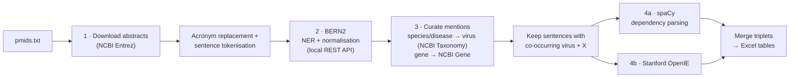
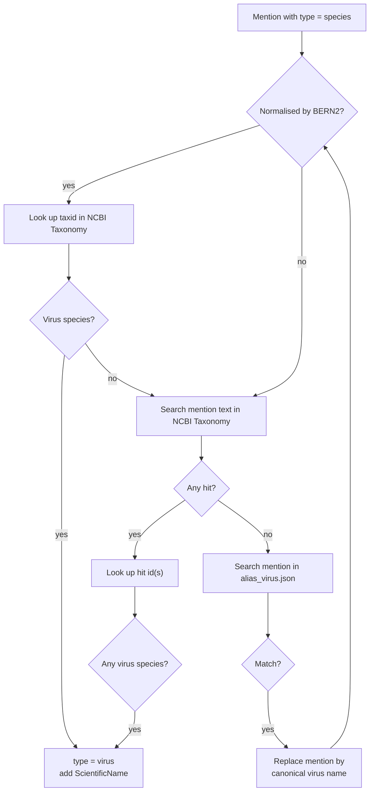

# virus_relations: automatic extraction of virus–gene relations from abstracts

`virus_relations` takes a list of **PubMed IDs** and returns the sentences in which a **virus** is related to another biomedical entity. That entity is usually a **gene/protein**, which is how candidate viral receptors are found, but it can also be a drug, a disease, a cell type and so on. The pipeline returns each relation as a *(term_1, relation, term_2)* triplet, with the virus and the other entity normalised to NCBI identifiers.

The design is based on **pubmedKB** (Li *et al.*, *Nucleic Acids Res* 2022, [doi:10.1093/nar/gkac310](https://doi.org/10.1093/nar/gkac310)). Its NER/NEN stage was replaced by **BERN2** (Sung *et al.*, *Bioinformatics* 2022). Virus-specific curation of mentions was added on top. Only the relational-phrase extractors (spaCy and OpenIE) are kept. R-BERT and T5 are not used.

---

## Table of contents

- [How it works](#how-it-works)
- [Local databases (cache)](#local-databases-cache)
- [Requirements and installation](#requirements-and-installation)
- [Configuration (`config.yaml`)](#configuration-configyaml)
- [Usage](#usage)
- [Output files](#output-files)
- [Preliminary validation](#preliminary-validation)
- [Known limitations](#known-limitations)
- [Code map](#code-map)
- [Credits](#credits)

---

## How it works



### Step 1 · Download and preprocess abstracts

- The abstracts of the PMIDs not yet in the local database are downloaded in parallel through **Biopython Entrez**. PMIDs without an abstract are written to `failed_pmids_*.txt`.
- **Acronyms are replaced by their long form** so that BERN2 can recognise and normalise them. Generic tools such as `replace_acronyms` from *nlpre* fail on virus acronyms such as *Ab-MuLV* (Abelson murine leukemia virus) or *EV70* (Echovirus 70), so a custom bracket/acronym resolver is used (`scripts/preprocess_abstract.py`).
- Abstracts are split into sentences with NLTK (`sent_tokenize`).

### Step 2 · Named-entity recognition with BERN2

A local **BERN2** server is started automatically (`scripts/launch_bern2_{cpu,gpu}.sh`) and queried at `http://localhost:8888/plain`, in batches of 500 sentences. BERN2 tags 9 entity types (gene/protein, species, disease, drug/chemical, mutation, cell line, cell type, DNA, RNA) and normalises them to identifiers. For example, *human* becomes `NCBITaxon:9606`.

### Step 3 · Mention curation

BERN2 has no *virus* type, so viruses are recovered from **species** (and optionally **disease**) mentions:



A taxon counts as a *virus species* (`is_virus_specie` in `scripts/process_mentions.py`) when its NCBI division is *Viruses* and its rank is *species*, or when it is a *no rank* / *serotype* node whose lineage includes a species. *Synthetic and Chimeric* entries with a virus lineage also count. The alias dictionary `databases/alias_virus.json` holds about 6 000 virus names with their common aliases and abbreviations. The plain list of names is in `other_resources/virus_6034.txt`.

Gene mentions are looked up in **NCBI Gene** to attach the official gene description, for example *ACE2 → angiotensin converting enzyme 2*.

Finally, only sentences that contain **both** entity types of at least one requested relation are kept, for example a virus and a gene (`filter_mentions`).

### Step 4 · Relation extraction

Each selected sentence is processed by two independent extractors adapted from pubmedKB:

- **spaCy** (`spacy/spacy_main.py`, model `en_core_web_sm`): dependency-based extraction of *subject–verb–object* phrases. It uses `spacy/verb_list.csv` to merge hyphenated verbs and detects negations.
- **Stanford OpenIE** (`openie/openie_main.py` + `openie.sh`): open information-extraction triplets.

Triplets whose two arguments contain the two entities of a requested relation are kept. `scripts/get_extracted_relations.py` merges the triplets from both tools into the final tables, labelled with their `source`.

---

## Local databases (cache)

Every intermediate result is stored as JSON in the directory set by `db_path`, which defaults to `databases/`. A new run only downloads and annotates PMIDs, mentions and IDs that are not already there, so repeated or incremental runs are much faster.

| File | Content |
|---|---|
| `abstracts.json` | Raw abstracts downloaded from PubMed, keyed by PMID |
| `annotated_abstracts.json` | BERN2 annotations per sentence |
| `annotated_parsed_abstracts.json` | Annotations after virus/gene curation |
| `species_mentions.json` | Species mention text → NCBI taxids |
| `genes_mentions.json` | Gene mention text → NCBI gene ids |
| `entrez_species.json` | Cached NCBI Taxonomy records |
| `entrez_genes.json` | Cached NCBI Gene records |
| `alias_virus.json` | *(shipped)* virus name → list of aliases |

Only `alias_virus.json` ships with the repository. The other files are created on the first run. `scripts/clean_annotated_abstracts_db.py` is a helper to clean the annotation database.

---

## Requirements and installation

The pipeline was developed and tested on **Ubuntu Linux with a GNOME desktop**. BERN2, spaCy and OpenIE are launched in separate `gnome-terminal` windows.

| Dependency | Notes |
|---|---|
| Python **3.8** virtual env in `env/` | `run_virus_relations.sh` activates `env/bin/activate` |
| Python packages | `pip install -r requirements.txt` |
| spaCy model | `python -m spacy download en_core_web_sm` |
| NLTK data | `python -c "import nltk; nltk.download('punkt')"` |
| **BERN2** | Clone and install [BERN2](https://github.com/dmis-lab/BERN2) into `automated_text_mining/BERN2/`, inside a conda env named **`bern2`** (Anaconda in `~/anaconda3`). A GPU is recommended. The pipeline calls `BERN2/scripts/run_bern2.sh` (GPU) or `run_bern2_cpu.sh` (CPU). |
| **Java** + Stanford CoreNLP | Put the CoreNLP `*.jar` files in `openie/jar_dir/`. |
| NCBI account | An e-mail and an [API key](https://www.ncbi.nlm.nih.gov/account/settings/) for Entrez |
| GPU *(optional)* | CUDA 10.1 for `cupy-cuda101`. Set `GPU: True` in the config. |

Expected layout after installation:

```
automated_text_mining/
├── BERN2/                  # BERN2 installation (not in this repo)
├── env/                    # Python 3.8 virtualenv (not in this repo)
├── databases/
├── openie/jar_dir/         # Stanford CoreNLP jars (not in this repo)
├── scripts/  spacy/  openie/
├── config.yaml
├── extract_virus_relations.py
└── run_virus_relations.sh
```

---

## Configuration (`config.yaml`)

### Run parameters (edit for every analysis)

| Key | Example | Description |
|---|---|---|
| `path` | `/home/user/projects/my_run` | **Absolute** path of the project directory. All outputs go here. |
| `pmids` | `pmids.txt` | Text file with one PMID per line, inside `path`. Duplicates are removed. |
| `output_tag` | `test_short` | Tag added to every output file name |
| `add_date` | `True` | Append the run date (`dd-mm-yyyy`) to output names |
| `relations` | see below | List of relation types to extract. **The first element must always be `virus`.** |

```yaml
relations:
- !!python/tuple [virus, gene]
- !!python/tuple [virus, drug]
```

Available mention types: `virus`, `gene`, `drug`, `mutation`, `species`, `cell_type`, `cell_line`, `disease`, `DNA`, `RNA`.

### Advanced parameters (change only if you know what you are doing)

| Key | Default | Description |
|---|---|---|
| `parse_species` | `True` | Recover viruses from BERN2 *species* mentions |
| `parse_disease` | `True` | Recover viruses from *disease* mentions (e.g. "HIV infection") |
| `parse_genes` | `True` | Normalise gene mentions against NCBI Gene |
| `db_path` | `…/automated_text_mining/databases` | Absolute path of the JSON cache |
| `GPU` | `False` | Run BERN2 and spaCy on GPU |
| `n_processes` | `[5, 10]` | Parallel processes (low, high) for the NCBI downloads |
| `entrez_mail` | | Your e-mail for NCBI Entrez |
| `entrez_api` | | Your NCBI API key. **Do not commit it.** |
| `entrez_maxtries` | `20` | Retries per Entrez request |
| `entrez_sleep_tries` | `0.5` | Seconds between retries |

---

## Usage

1. Create a project directory and put your PMID list in it:

   ```
   /home/user/projects/my_run/
   └── pmids.txt
   ```

2. Edit `config.yaml` (`path`, `pmids`, `output_tag`, `relations`, NCBI credentials).

3. Start the pipeline from the `automated_text_mining/` folder:

   ```bash
   cd automated_text_mining
   ```

   ```bash
   bash run_virus_relations.sh
   ```

The terminal shows the progress of each step: downloading abstracts, processing them, launching BERN2, the BERN2 annotation batches, searching NCBI Taxonomy and Gene, filtering mentions, spaCy, OpenIE, and a final summary. BERN2 opens its own terminal window and shuts down automatically when annotation ends. If a run is interrupted and BERN2 is left running on port 8888, stop it manually:

```bash
bash scripts/close_bern2_cpu.sh
```

(or `scripts/close_bern2_gpu.sh`).

Example final summary:

```
- 680 sentences annotated from 88 unique PMIDS (3 failed).
- 237 sentences with co-occurring virus-gene or virus-drug mentions, corresponding to 77 abstracts.
- A total of 65 sentences with virus-gene or virus-drug relations:
    - 57 sentences with virus-gene relation, corresponding to 33 abstracts.
    - 8 sentences with virus-drug relation, corresponding to 4 abstracts.
- All relations saved in all_relations_test_short_29-03-2023.json
...
PROGRAM FINISHED
```

---

## Output files

File names follow the pattern `{file_tag}_{output_tag}_{date}_{N}.ext`. `_{date}` is added only when `add_date: True`. `_{N}` is added only when a file with the same name already exists, so earlier runs are not overwritten.

```
my_run/
├── pmids.txt
├── config_test_short_29-03-2023.yaml            # copy of the config used
├── failed_pmids_test_short_29-03-2023.txt       # PMIDs that could not be downloaded
├── stats_test_short_29-03-2023.txt              # run summary
├── all_relations_test_short_29-03-2023.xlsx     # all relations (several relation types)
├── virus_gene_relations_test_short_29-03-2023.xlsx
├── virus_drug_relations_test_short_29-03-2023.xlsx
└── temp/
    ├── abstracts_annotated_test_short_29-03-2023.json         # BERN2 output
    ├── abstracts_annotated_parsed_test_short_29-03-2023.json  # after curation
    ├── mentions_test_short_29-03-2023.json                    # sentences with co-occurring entities
    ├── spacy_relations_test_short_29-03-2023.{json,xlsx}
    └── openie_relations_test_short_29-03-2023.{json,xlsx}
```

If only one relation type is requested, a single `virus_<type>_relations_*.xlsx` file is written.

### Relation table columns

| Column | Description |
|---|---|
| `pmid` | PubMed ID of the abstract |
| `sent_id` | Sentence index within the run |
| `term_1` | First argument of the triplet |
| `relation` | Relational phrase (e.g. *binds to*, *is cellular receptor for*) |
| `term_2` | Second argument of the triplet |
| `virus` | Virus mention and its normalised name, e.g. `SARS coronavirus (Severe acute respiratory syndrome coronavirus)` |
| `gene` / `drug` / … | Other entity: mention and normalised name or identifier, e.g. `Angiotensin-converting enzyme 2 (angiotensin converting enzyme 2)` |
| `source` | Extractor that found the triplet: `Spacy` or `OpenIE` |
| `sentence` | Full original sentence, for manual review |

When several relation types go into the same table (`all_relations_*.xlsx`), the other entity is in column `other_entity` and its type is in `relation_with`.

---

## Preliminary validation

> These are **internal, preliminary results** from February 2023, obtained during development. See the paper for the final evaluation.

The pipeline was run on a manually curated set of **380 abstracts**: 235 describing a known virus–receptor relation (105 viruses) and 145 negative abstracts.

| Stage | Count |
|---|---|
| Input abstracts | 380 (235 positive / 145 negative) |
| Sentences with co-occurring virus–gene mentions | 935 |
| Unique extracted relations | 298 |
| Relations judged positive | 121 (13 wrong → 89 % correct) |

Confusion matrix at the abstract level (manual vs automatic):

|  | Automatic 0 | Automatic 1 |
|---|---|---|
| **Manual 0** | 137 | 8 |
| **Manual 1** | 166 | 69 |

| Metric | Value |
|---|---|
| Precision | 0.90 |
| Sensitivity (recall) | 0.29 |
| Specificity | 0.94 |
| Accuracy | 0.54 |

In this test, 46 % of the manually curated relations were recovered, and relations were detected for 63 % of the viruses. The pipeline is therefore **high-precision, low-recall**: it is meant to prioritise literature and propose candidates for manual curation, not to replace curation.

Most errors came from gene mention recognition and normalisation. For example, *chondroitin sulfate B* was normalised to *granzyme B*.

---

## Known limitations

- **Abstracts only**: full texts are not processed.
- **Absolute paths in the config**: `path` and `db_path` in `config.yaml` must point to your project and database directories. The main script itself moves to its own folder at start-up, so the repository can be installed anywhere.
- **Desktop required**: BERN2, spaCy and OpenIE are launched with `gnome-terminal`. On a headless server, replace the `scripts/launch_*.sh` wrappers with direct calls to the corresponding `scripts/open_*.sh` / `scripts/run_*.sh`.
- Recall is limited mainly by gene NER/normalisation and by relations spread over several sentences.

---

## Code map

| File | Role |
|---|---|
| `run_virus_relations.sh` | Activates `env/` and runs the main script |
| `extract_virus_relations.py` | Orchestrates the whole pipeline: config, caching, steps 1–4, output files |
| `scripts/entrez_functions.py` | JSON database helpers, Entrez download of abstracts, taxonomy and genes, mention → ID search |
| `scripts/preprocess_abstract.py` | Text cleaning, acronym/bracket replacement, sentence splitting, BERN2 client |
| `scripts/process_mentions.py` | Virus detection from species/disease mentions, gene normalisation, co-occurrence filter |
| `scripts/get_extracted_relations.py` | Selects the triplets that match the requested relations and builds the DataFrames |
| `scripts/*bern2*.sh` | Start, stop and clean up the local BERN2 server |
| `scripts/launch_*.sh`, `scripts/run_*.sh` | Start spaCy and OpenIE in a new terminal |
| `spacy/` | spaCy relation extractor (adapted from pubmedKB) |
| `openie/` | OpenIE relation extractor (adapted from pubmedKB) |

---

## Credits

- **pubmedKB**: Li P-H *et al.* *Nucleic Acids Res* 2022;50(W1):W616–W622. The spaCy and OpenIE modules are adapted from it.
- **BERN2**: Sung M *et al.* *Bioinformatics* 2022;38(20):4837–4839.
- **Stanford OpenIE**: Angeli G *et al.* ACL 2015.
- **spaCy**: Explosion AI.

Author of the pipeline: Carlos Baeza-Delgado (Sanjuán Lab, I2SysBio).
